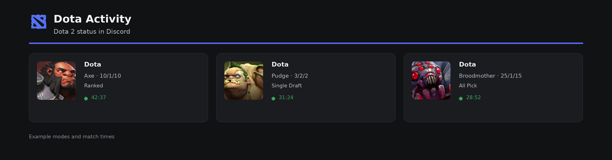
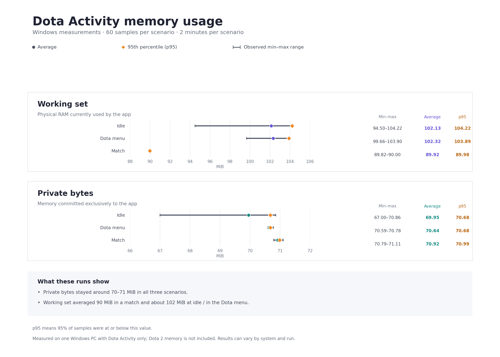

<p align="center">
  
</p>

<h1 align="center">Dota Activity</h1>

<p align="center">A small Windows app that shows your Dota 2 status in Discord.</p>

<p align="center">
  <a href="README.ru.md">Русский</a>
</p>

<p align="center">
  <a href="https://github.com/Kolt5ik/DotaActivity/releases/latest"></a>
  <br>
  <sub>Windows 10/11 · 64-bit</sub>
</p>

<p align="center">
  <a href="https://github.com/Kolt5ik/DotaActivity/releases/latest"></a>
  <a href="https://github.com/Kolt5ik/DotaActivity/actions/workflows/build-windows.yml"></a>
  
  <a href="LICENSE"></a>
</p>

<p align="center">
  
</p>

<p align="center"><sub>Illustrative match modes and timers.</sub></p>

## What it does

Dota Activity connects Dota 2 to Discord Rich Presence. It picks up game state automatically and shows useful details while you play, then clears your activity when you close the game.

There is no account linking or lobby setup. The app finds your Steam installation, configures Dota's Game State Integration (GSI), and connects to the Discord desktop app.

## Download

Get the latest Windows x64 build from [GitHub Releases](https://github.com/Kolt5ik/DotaActivity/releases/latest). Download the file named `DotaActivity-<version>-Windows-x64.exe` and open it. Python is not required.

You will need:

- Windows 10 or 11, 64-bit
- Dota 2 installed through Steam
- The Discord desktop app running

## First launch

1. Open Discord and run Dota Activity.
2. The app will look for Dota 2 in your Steam libraries and install the GSI configuration automatically.
3. Start Dota 2. If the game was already open the first time, restart it once so it loads the new configuration.
4. Your Discord activity appears while Dota 2 is running. Close the game to clear it.

## What appears in Discord

- During hero selection and the pre-game screen, the activity uses the centered Dota logo.
- During a match, it can show your hero, K/D/A, game mode, and match time when Dota provides those details.
- Ranked, Turbo, training, and bot matches are identified from the game data where possible.

The available details depend on the current game state and the information Dota sends through GSI.

## Day-to-day use

- **Language:** English is selected by default. Choose Russian in the app window to switch languages; the choice is saved.
- **Run with Windows:** Turn on the autostart option in the main window. It starts minimized to the system tray when you sign in.
- **System tray:** Closing the window hides the app in the tray. Use **Exit** in the tray menu to stop it completely.
- **Updates:** The app checks GitHub Releases for a newer stable version. Before installation it checks the downloaded executable against GitHub's SHA-256 asset digest. After you accept, it replaces its current `.exe` only after the new copy reports successful startup; otherwise it restores and relaunches the previous copy.

## Performance and memory use

We measured Dota Activity on Windows in three scenarios: idle, the Dota menu, and a match. Each scenario was sampled 60 times over two minutes. In these runs, average private bytes stayed around 70–71 MiB. Average working set was about 102 MiB at idle and in the menu, and about 90 MiB in a match.

Working set is the app memory currently resident in physical RAM. Private bytes is memory committed exclusively to Dota Activity. The measurements cover the DotaActivity process only; they do not include Dota 2 or Discord. Results are from one PC and can vary between systems and runs. The chart includes the observed min–max range and p95.



## Medal Rich Presence

Medal can publish its own Rich Presence to Discord. DotaActivity cannot assign its activity a higher priority than another app's presence, so Medal's status may appear instead. To let DotaActivity show in Discord, turn off **Promote my Medal profile using Rich Presence** in Medal under **Settings → Privacy & Security → Privacy & Visibility**. See [Medal's support guide](https://support.medal.tv/support/solutions/articles/48001159956) for details. Medal itself can stay open; this disables its Rich Presence promotion.

## If Discord activity is missing

1. Make sure the Discord **desktop app** is open.
2. Check that Dota Activity reports that it found Dota 2 and configured GSI.
3. If Dota 2 was open during the first setup, restart the game.
4. Use **Repair GSI** in the app if the local connection is unavailable, then restart Dota 2.
5. Start a match or enter the game again. Some details only become available after the match begins.

## How it works and privacy

The source code is open under the MIT License and available for review. Dota 2 sends game-state updates to a local address on your PC (`127.0.0.1`), and Dota Activity publishes the Rich Presence through the Discord desktop app. The app does not ask for your Steam password or send game-state data to a Dota Activity server. It contacts GitHub to check for releases and download an update only if you choose to install one. The GSI token is a local shared secret between Dota and the app; it is not a Discord or Steam account token. Do not include it in screenshots or diagnostic reports.

## Build from source

The app is written in Python and currently targets Windows. To run it from a checkout:

```powershell
py -m venv .venv
.\.venv\Scripts\Activate.ps1
python -m pip install -r requirements.txt
python app.py
```

Run the tests with:

```powershell
python -m unittest discover -s tests -v
```

Pull requests targeting `main` run the test suite and build a Windows test executable through GitHub Actions.

## License and credits

The source code is released under the [MIT License](LICENSE). The project logo and artwork are separate assets and are not covered by that license. Dota 2 and Discord are trademarks of their respective owners. Dota Activity is an unofficial community project and is not affiliated with Valve or Discord.

Created by [Kolt5ik](https://github.com/Kolt5ik).
