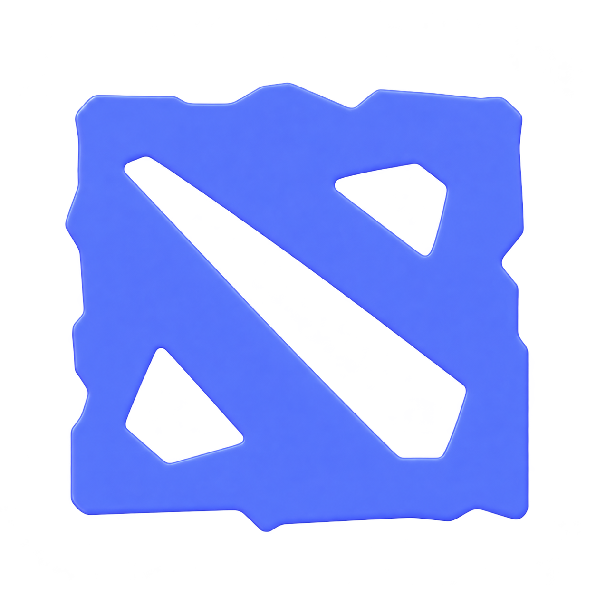
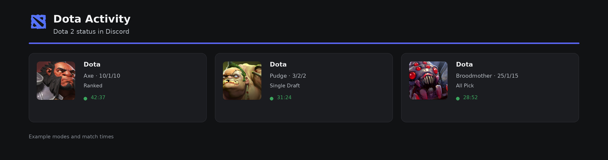
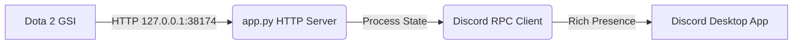

<p align="center">
  
</p>

<h1 align="center">Dota Activity</h1>

<p align="center">Lightweight Windows app displaying Dota 2 match status in Discord.</p>

<p align="center">
  <a href="README.ru.md">Русский</a>
</p>

<p align="center">
  <a href="https://github.com/Kolt5ik/DotaActivity/releases/latest"></a>
  <br>
  <sub>Windows 10/11 · 64-bit</sub>
</p>

<p align="center">
  <a href="https://github.com/Kolt5ik/DotaActivity/releases/latest"></a>
  <a href="https://github.com/Kolt5ik/DotaActivity/actions/workflows/build-windows.yml"></a>
  
  <a href="LICENSE"></a>
</p>

<p align="center">
  
</p>

<p align="center"><sub>Illustrative match modes and timers.</sub></p>

## What it does

Dota Activity connects Dota 2 to Discord Rich Presence. It picks up game state automatically and shows useful details while you play, then clears your activity when you close the game.

There is no account linking or lobby setup. The app finds your Steam installation, configures Dota's Game State Integration (GSI), and connects to the Discord desktop app.

## Before / After

| Without Dota Activity | With Dota Activity |
|---|---|
| Discord shows generic "Playing a game" or nothing at all. | Discord displays your active Dota 2 hero, K/D/A, game mode, and match duration in real time. |
| Manual editing of GSI configuration files in Steam folders. | Automatic Steam library scanning and GSI configuration setup. |

## Features

- **Automatic GSI Setup:** Finds Steam libraries and configures `gamestate_integration_dotapresence.cfg` automatically.
- **Discord Rich Presence:** Publishes hero, K/D/A, game mode, and match time to Discord RPC.
- **System Tray Integration:** Runs in the system tray with minimize and exit options.
- **Windows Autostart:** Optional startup integration via the Windows registry Run key.
- **Secure Auto-Updates:** Checks GitHub Releases, verifies SHA-256 digests, and includes automatic rollback on startup failure.
- **Language Support:** English and Russian localization with settings persistence in `%APPDATA%\DotaActivity\settings.json`.

## Quick start

1. Download the latest `DotaActivity-<version>-Windows-x64.exe` from [GitHub Releases](https://github.com/Kolt5ik/DotaActivity/releases/latest).
2. Open the Discord desktop app and run `DotaActivity.exe`.
3. Start Dota 2 (restart the game once if it was already open during the initial setup).

## Usage

| Action / Control | Description |
|---|---|
| Main Window | Shows current connection status, game state, and toggle buttons. |
| **Repair GSI** | Recreates or fixes the local GSI configuration file if game state updates stop. |
| **Check for updates** | Queries GitHub Releases for newer versions and verifies SHA-256 asset hashes. |
| **Language** | Switches interface language between English and Russian (persisted locally). |
| Tray menu / Exit | Minimizes to system tray or fully terminates the application. |

## Configuration

| Setting / Parameter | Required | Description | Default / Example |
|---|---|---|---|
| `settings.json` | No | Persists language preference and autostart state. | `%APPDATA%\DotaActivity\settings.json` |
| `gamestate_integration_dotapresence.cfg` | Yes | Dota 2 GSI configuration file written to Steam Dota path. | Managed automatically by app |

## How it works

Dota 2 communicates game state events over local HTTP port `38174` via Game State Integration (GSI). `app.py` runs a lightweight HTTP server receiving these JSON payloads, processes player stats, and synchronizes Rich Presence with Discord through the local RPC client.



## Project structure

```text
DotaActivity/
├── app.py                  # Main application, HTTP server, GUI, and Discord RPC
├── requirements.txt        # Python package dependencies
├── build.bat               # PyInstaller build script for Windows executable
├── run.bat                 # Convenience script to run app locally
├── version_info.txt        # Windows executable version metadata
├── SECURITY.md / .ru.md    # Security policy and vulnerability reporting
├── LICENSE                 # MIT License
├── assets/                 # Icons, logos, and UI showcase images
└── tests/                  # Unit and integration test suite
```

## Tests and development

To run tests locally from source:

```powershell
py -m venv .venv
.\.venv\Scripts\Activate.ps1
python -m pip install -r requirements.txt
python -m unittest discover -s tests -v
```

To build the Windows executable:

```powershell
build.bat
```

## Scope

- Designed exclusively for Windows 10/11 (64-bit).
- Does not modify core game binaries or violate Valve / Discord terms of service.
- Does not store or transmit user telemetry or credentials.

## FAQ

<details>
<summary><b>Why is my Discord activity missing?</b></summary>

Make sure the Discord desktop app is running, Dota Activity successfully connected to Dota 2 GSI, and (if the game was open during setup) restart Dota 2. You can also click **Repair GSI** in the app.
</details>

<details>
<summary><b>Do I need Python installed?</b></summary>

No. If you download the precompiled `.exe` from [GitHub Releases](https://github.com/Kolt5ik/DotaActivity/releases/latest), Python is not required. Python is only needed if building from source.
</details>

<details>
<summary><b>Why is Medal TV hiding Dota Activity status?</b></summary>

Medal can override Discord Rich Presence. In Medal settings, go to **Settings → Privacy & Security → Privacy & Visibility** and turn off **Promote my Medal profile using Rich Presence**.
</details>

## Contributing and license

Contributions, bug reports, and pull requests are welcome. 

The source code is released under the [MIT License](LICENSE). Dota 2 and Discord are trademarks of their respective owners. Created by [Kolt5ik](https://github.com/Kolt5ik).
