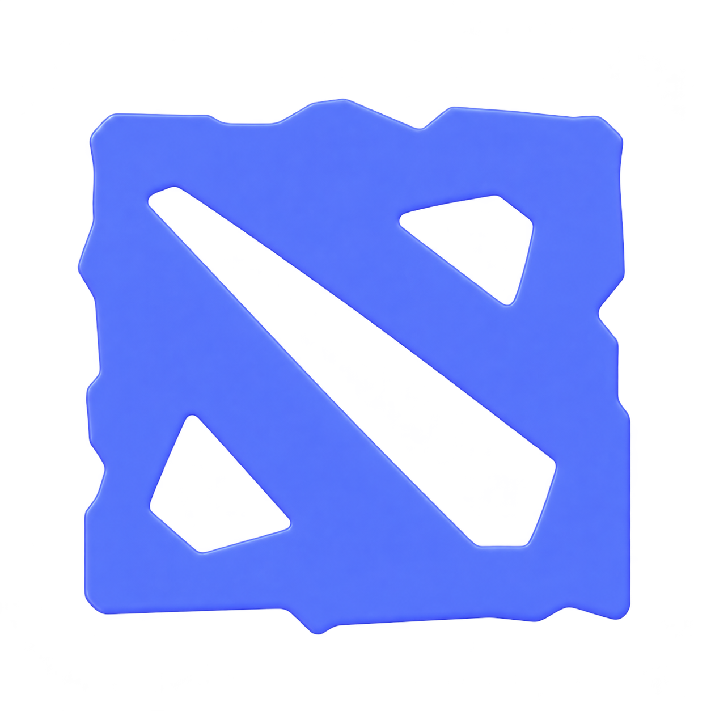
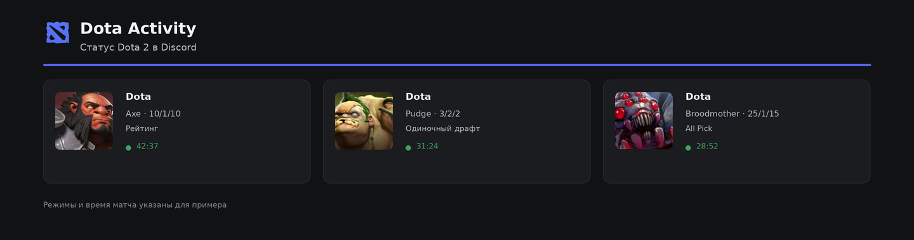
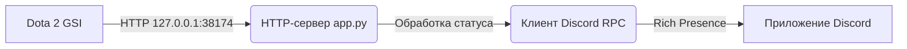

<p align="center">
  
</p>

<h1 align="center">Dota Activity</h1>

<p align="center">Небольшое приложение для Windows, которое показывает статус Dota 2 в Discord.</p>

<p align="center">
  <a href="README.md">English</a>
</p>

<p align="center">
  <a href="https://github.com/Kolt5ik/DotaActivity/releases/latest"></a>
  <br>
  <sub>Windows 10/11 · 64-разрядная версия</sub>
</p>

<p align="center">
  <a href="https://github.com/Kolt5ik/DotaActivity/releases/latest"></a>
  <a href="https://github.com/Kolt5ik/DotaActivity/actions/workflows/build-windows.yml"></a>
  
  <a href="LICENSE"></a>
</p>

<p align="center">
  
</p>

<p align="center"><sub>Режимы и таймеры в примерах указаны для демонстрации.</sub></p>

## Что делает приложение

Dota Activity связывает Dota 2 с Discord Rich Presence. Приложение автоматически получает данные об игре и показывает их в статусе Discord, а после выхода из Dota 2 убирает активность.

Привязывать аккаунт или вручную настраивать лобби не нужно. Приложение находит Dota 2 в библиотеках Steam, настраивает Game State Integration (GSI) и подключается к настольному Discord.

## До / После

| Без Dota Activity | С Dota Activity |
|---|---|
| Discord показывает общую активность «Играет в игру» или ничего. | Discord в реальном времени отображает текущего героя Dota 2, K/D/A, режим игры и длительность матча. |
| Ручная правка конфигурационных файлов GSI в папках Steam. | Автоматический поиск библиотек Steam и настройка GSI. |

## Возможности

- **Автоматическая настройка GSI:** поиск библиотек Steam и установка `gamestate_integration_dotapresence.cfg`.
- **Discord Rich Presence:** передача героя, K/D/A, режима игры и времени матча в Discord RPC.
- **Интеграция с системным треем:** свёртывание в трей с возможностью выхода и восстановления окна.
- **Автозапуск в Windows:** опциональный автозапуск через реестр Windows (`Run`).
- **Безопасные автообновления:** проверка релизов на GitHub, проверка SHA-256 хэшей и автоматический откат при сбое старта.
- **Поддержка языков:** русский и английский интерфейс с сохранением настроек в `%APPDATA%\DotaActivity\settings.json`.

## Быстрый старт

1. Скачайте последнюю версию `DotaActivity-<версия>-Windows-x64.exe` со страницы [GitHub Releases](https://github.com/Kolt5ik/DotaActivity/releases/latest).
2. Запустите настольный Discord и приложение `DotaActivity.exe`.
3. Запустите Dota 2 (перезапустите игру один раз, если она была открыта во время первой настройки).

## Использование

| Действие / Элемент | Описание |
|---|---|
| Главное окно | Отображает текущий статус подключения, состояние игры и кнопки управления. |
| **Восстановить GSI** | Создаёт или исправляет локальный файл конфигурации GSI при потере связи. |
| **Проверить обновления** | Запрашивает новые релизы на GitHub и проверяет SHA-256 хэш скачанного файла. |
| **Язык** | Переключение языка интерфейса между русским и английским (сохраняется локально). |
| Меню трея / Выход | Сворачивает в трей или полностью завершает работу приложения. |

## Конфигурация

| Параметр / Файл | Обязательно | Описание | Пример / Путь |
|---|---|---|---|
| `settings.json` | Нет | Сохраняет выбранный язык и настройку автозапуска. | `%APPDATA%\DotaActivity\settings.json` |
| `gamestate_integration_dotapresence.cfg` | Да | Файл конфигурации GSI для Dota 2 в папке игры. | Создаётся приложением автоматически |

## Как это устроено

Dota 2 отправляет события состояния игры на локальный HTTP-порт `38174` через Game State Integration (GSI). Файл `app.py` запускает лёгкий HTTP-сервер для получения этих JSON-данных, обрабатывает статистику игрока и синхронизирует Rich Presence с Discord через локальный клиент RPC.



## Структура проекта

```text
DotaActivity/
├── app.py                  # Основной код приложения, HTTP-сервер, GUI и Discord RPC
├── requirements.txt        # Зависимости Python
├── build.bat               # Скрипт сборки PyInstaller для Windows EXE
├── run.bat                 # Вспомогательный скрипт для локального запуска
├── version_info.txt        # Метаданные версии Windows EXE
├── SECURITY.md / .ru.md    # Политика безопасности и уязвимости
├── LICENSE                 # Лицензия MIT
├── assets/                 # Иконки, логотипы и демонстрационные изображения
└── tests/                  # Набор модульных и интеграционных тестов
```

## Тесты и разработка

Для запуска тестов из исходного кода:

```powershell
py -m venv .venv
.\.venv\Scripts\Activate.ps1
python -m pip install -r requirements.txt
python -m unittest discover -s tests -v
```

Для сборки исполняемого файла Windows:

```powershell
build.bat
```

## Границы проекта (Scope)

- Приложение разработано исключительно для Windows 10/11 (64-разрядная).
- Не изменяет основные исполняемые файлы игр и не нарушает правила Valve или Discord.
- Не собирает и не передаёт сторонним серверам пользовательские данные или учетные записи.

## FAQ

<details>
<summary><b>Что делать, если статус в Discord не появляется?</b></summary>

Убедитесь, что запущен настольный Discord, Dota Activity успешно подключилась к GSI Dota 2, и (если игра была открыта при запуске) перезапустите Dota 2. Также можно нажать кнопку **Восстановить GSI** в приложении.
</details>

<details>
<summary><b>Нужен ли установленный Python?</b></summary>

Нет. Если вы скачиваете готовый `.exe` файл со страницы [GitHub Releases](https://github.com/Kolt5ik/DotaActivity/releases/latest), Python не требуется. Python нужен только при сборке из исходного кода.
</details>

<details>
<summary><b>Почему Medal TV перекрывает статус Dota Activity?</b></summary>

Medal может переопределять Discord Rich Presence. В настройках Medal откройте **Settings → Privacy & Security → Privacy & Visibility** и отключите параметр **Promote my Medal profile using Rich Presence**.
</details>

## Лицензия и авторство

Участие в разработке, сообщения об ошибках и Pull Request приветствуются.

Исходный код распространяется под [лицензией MIT](LICENSE). Dota 2 и Discord являются товарными знаками соответствующих владельцев. Создатель: [Kolt5ik](https://github.com/Kolt5ik).
