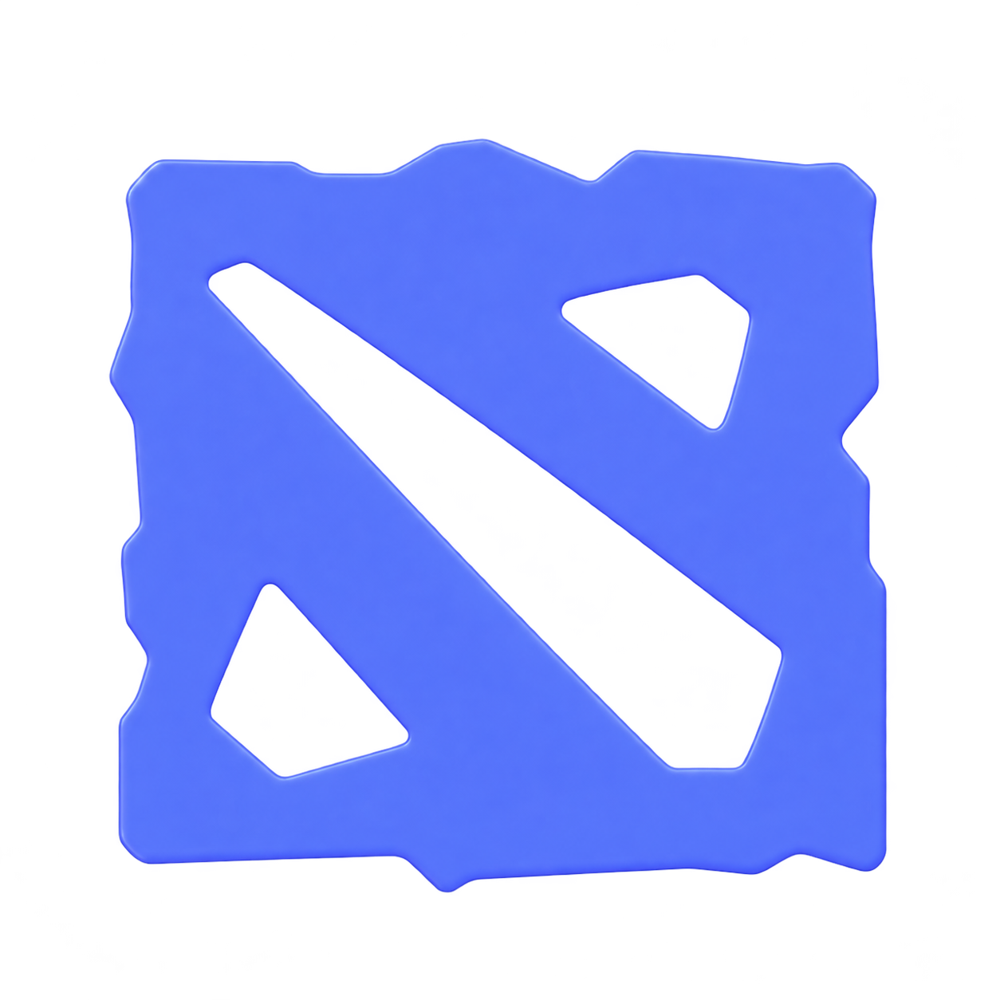
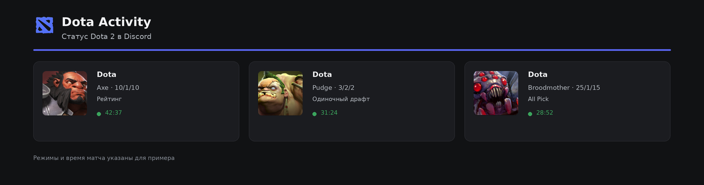
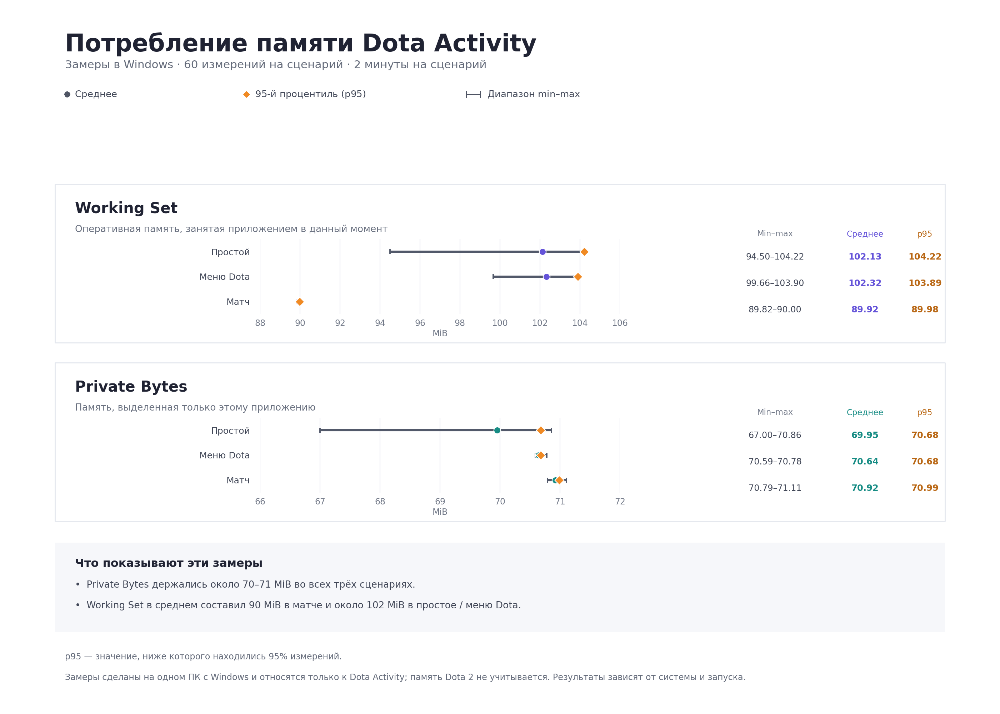

<p align="center">
  
</p>

<h1 align="center">Dota Activity</h1>

<p align="center">Небольшое приложение для Windows, которое показывает статус Dota 2 в Discord.</p>

<p align="center">
  <a href="README.md">English</a>
</p>

<p align="center">
  <a href="https://github.com/Kolt5ik/DotaActivity/releases/latest"></a>
  <br>
  <sub>Windows 10/11 · 64-разрядная версия</sub>
</p>

<p align="center">
  <a href="https://github.com/Kolt5ik/DotaActivity/releases/latest"></a>
  <a href="https://github.com/Kolt5ik/DotaActivity/actions/workflows/build-windows.yml"></a>
  
  <a href="LICENSE"></a>
</p>

<p align="center">
  
</p>

<p align="center"><sub>Режимы и таймеры в примерах указаны для демонстрации.</sub></p>

## Что делает приложение

Dota Activity связывает Dota 2 с Discord Rich Presence. Приложение автоматически получает данные об игре и показывает их в статусе Discord, а после выхода из Dota 2 убирает активность.

Привязывать аккаунт или вручную настраивать лобби не нужно. Приложение находит Dota 2 в библиотеках Steam, настраивает Game State Integration (GSI) и подключается к настольному Discord.

## Скачать

Последнюю сборку для Windows x64 можно скачать на странице [GitHub Releases](https://github.com/Kolt5ik/DotaActivity/releases/latest). Выберите файл `DotaActivity-<версия>-Windows-x64.exe` и запустите его. Устанавливать Python не нужно.

Понадобятся:

- Windows 10 или 11, 64-разрядная версия
- Dota 2, установленная через Steam
- Запущенное настольное приложение Discord

## Первый запуск

1. Откройте Discord и запустите Dota Activity.
2. Приложение найдёт Dota 2 в библиотеках Steam и автоматически установит конфигурацию GSI.
3. Запустите Dota 2. Если игра была открыта во время первой настройки, перезапустите её один раз, чтобы она загрузила новую конфигурацию.
4. Статус в Discord будет виден, пока запущена Dota 2. После выхода из игры он исчезнет.

## Что отображается в Discord

- Во время выбора героя и подготовки к матчу показывается стандартный логотип Dota, выровненный по центру.
- Во время матча приложение может показывать героя, K/D/A, режим игры и длительность матча — если Dota передаёт эти данные.
- Рейтинговый режим, Turbo, тренировочные матчи и игры с ботами различаются по данным игры, когда это возможно.

Состав статуса зависит от этапа игры и данных, которые Dota передаёт через GSI.

## Повседневное использование

- **Язык:** по умолчанию выбран английский. В окне приложения можно переключить интерфейс на русский; выбор сохранится.
- **Запуск вместе с Windows:** включите автозапуск в главном окне. При входе в систему приложение запустится свёрнутым в трей.
- **Системный трей:** при нажатии на крестик окно скрывается в трее. Чтобы полностью закрыть программу, выберите **Exit** в меню значка.
- **Обновления:** приложение проверяет GitHub Releases на наличие новой стабильной версии. Перед установкой оно сверяет SHA-256 скачанного EXE с дайджестом файла в GitHub. После подтверждения приложение заменит текущий `.exe` только когда новая копия подтвердит успешный запуск; при ошибке оно восстановит и перезапустит прежнюю версию.

## Производительность и использование памяти

Мы измерили потребление памяти Dota Activity в Windows в трёх сценариях: простой, меню Dota и матч. В каждом сценарии было 60 измерений за две минуты. В этих замерах средний показатель Private Bytes держался около 70–71 MiB. Средний Working Set составил около 102 MiB в простое и меню и около 90 MiB в матче.

Working Set показывает, сколько памяти приложения в данный момент находится в оперативной памяти. Private Bytes — память, выделенная только Dota Activity. Замеры относятся только к процессу DotaActivity и не включают Dota 2 или Discord. Это результаты одного ПК; на других системах и при повторном запуске значения могут отличаться. На графике также показаны диапазон min–max и p95.



## Rich Presence Medal

Medal может публиковать собственный Rich Presence в Discord. DotaActivity не может назначить своей активности более высокий приоритет, поэтому вместо неё может отображаться статус Medal. Чтобы в Discord показывалась активность DotaActivity, отключите в Medal параметр **Promote my Medal profile using Rich Presence**: **Settings → Privacy & Security → Privacy & Visibility**. Подробности есть в [справке Medal](https://support.medal.tv/support/solutions/articles/48001159956). Сам Medal можно оставить запущенным — эта настройка отключает публикацию его Rich Presence.

## Если статус Discord не появился

1. Убедитесь, что открыт **настольный Discord**.
2. Проверьте, что Dota Activity нашло Dota 2 и настроило GSI.
3. Если во время первой настройки Dota 2 уже была запущена, перезапустите игру.
4. Если локальное подключение недоступно, нажмите **Repair GSI** в приложении и перезапустите Dota 2.
5. Запустите матч или снова войдите в игру. Некоторые сведения появляются только после начала матча.

## Как это работает и какие данные использует

Исходный код открыт и распространяется по лицензии MIT — его можно посмотреть и проверить. Dota 2 отправляет данные о состоянии игры на локальный адрес компьютера (`127.0.0.1`), а Dota Activity публикует статус через настольный Discord. Приложение не запрашивает пароль Steam и не отправляет игровые данные на сервер Dota Activity. К GitHub оно обращается для проверки релизов и загрузки обновления только по вашему выбору. GSI-токен — это локальный общий секрет между Dota и приложением, а не токен Discord или Steam. Не прикладывайте его к скриншотам и диагностическим отчётам.

## Запуск из исходного кода

Приложение написано на Python и сейчас рассчитано на Windows. Чтобы запустить его из копии репозитория:

```powershell
py -m venv .venv
.\.venv\Scripts\Activate.ps1
python -m pip install -r requirements.txt
python app.py
```

Запустить тесты можно командой:

```powershell
python -m unittest discover -s tests -v
```

Для Pull Request в `main` GitHub Actions запускает тесты и собирает тестовый EXE для Windows.

## Лицензия и авторство

Исходный код распространяется по [лицензии MIT](LICENSE). Логотип и другие материалы проекта являются отдельными файлами и лицензией MIT не покрываются. Dota 2 и Discord — товарные знаки соответствующих владельцев. Dota Activity — неофициальный проект сообщества, не связанный с Valve или Discord.

Автор: [Kolt5ik](https://github.com/Kolt5ik).
